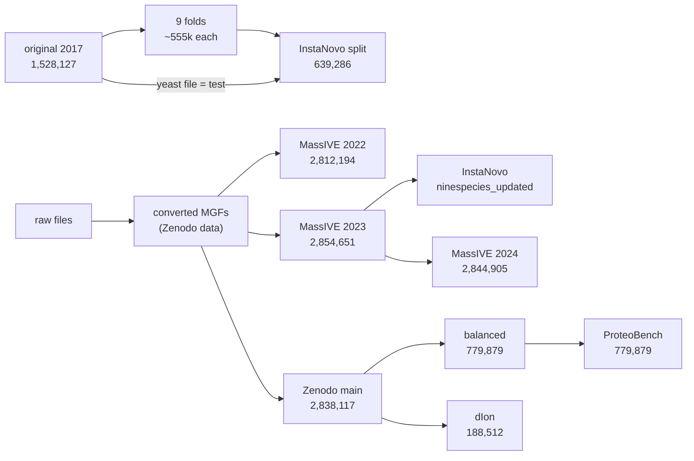

# The nine-species benchmark, version by version

"Evaluated on nine-species" names at least ten different sets of spectra. This
file puts every public copy of the benchmark on one spectrum key, `(species, raw
file, scan)`, and follows each spectrum from one version to the next: whether it
stays, which split it lands in, whether its label changes, and whether the
spectrum itself does. Written 2026-10-20 from the files as published that day.
The code is in [`analysis/nine_species/`](analysis/nine_species/); every number
below is an exact count from it unless it says otherwise.

Read [`BENCHMARKS.md`](BENCHMARKS.md) first for the retrained-versus-released
trap. This file is the data underneath it: which spectra a number was computed
over.

## The versions

| version | where | spectra | backbones | made by |
|---|---|---:|---:|---|
| **original** | MSV000081382, `HighResolution/data/high.<species>/peaks.db.mgf` | 1,528,127 | 242,687 | PEAKS DB exports, one MGF per species (DeepNovo, 2017) |
| original folds | same deposit, `cross.9high_80k.exclude_<species>` | 9 × 555,000 to 598,000 | | about 80,000 spectra per species sampled once (mouse and *V. mungo* whole); each fold drops one species and splits the rest into train, valid and test |
| **InstaNovo split** | Hugging Face `InstaDeepAI/ms_ninespecies_benchmark`, `10.57967/hf/3821` | 639,286 | 163,769 | the yeast-excluded fold's train (499,402) and valid (28,572), plus the original yeast species file as test (111,312) |
| **MassIVE 2022** | MSV000090982, `peak/` | 2,812,194 | 171,932 | the first revised search: Tide and Percolator over ThermoRawFileParser MGFs, no N-terminal modifications |
| **MassIVE 2023** | MSV000090982, `updates/2023-03-08_woutb_2c43c18c` | 2,854,651 | 168,421 | a re-search; identical, record for record, to InstaNovo's `data/ninespecies_updated/*.ipc` |
| **MassIVE 2024** | MSV000090982, `updates/2024-05-14_woutb_71950b89` | 2,844,905 | 168,443 | the 2023 search, with peptides shared between species redrawn |
| **Zenodo main** | `10.5281/zenodo.13685813`, `nine-species-main.zip` | 2,838,117 | 168,422 | the published benchmark (Wen & Noble 2024); the first build with no backbone in two species |
| **Zenodo balanced** | same record, `nine-species-balanced.zip` | 779,879 | 133,232 | 150 whole raw files of main, chosen to even out the species |
| **ProteoBench** | `nine_species_balanced_De_Novo.mgf.gz` | 779,879 | 133,232 | balanced, record for record, with the species dropped and scans renumbered |
| **dIon** | Hugging Face `alfred-n/dIon-datasets`, `representation_benchmarks/ninespecies` | 188,512 | 31,018 | a subset of main: 3,653 peptides per species for test, 100 for validation, up to about ten spectra each |

The same record also holds `nine-species-intermediate.zip` (the Tide and
Percolator output: 8,145,796 target PSMs over 8,054,115 scans) and
`nine-species-data.zip`, the converted MGFs before any search
(15,165,161 MS2 spectra, the total of the paper's Table 1).

A **backbone** is the bare sequence with I and L folded together, which is the
grain at which two labels can be the same peptide. The original deposit writes
every leucine as I: not one of its labels contains an L. Compare labels across
versions without folding I and L, and 524,296 of the spectra the original shares
with Zenodo main look like label changes.

## How the versions descend

The original and the revised benchmark share raw files and nothing else: the
revised benchmark re-converted every raw file, re-searched it, and relabelled it
from scratch. The three MassIVE releases share their peak lists exactly (every
spectrum present in two releases has the same precursor, charge, retention time
and peaks), so they differ only in which spectra are in and what each is
labelled. Zenodo main also shares those peak lists, and is not any of the three
MassIVE releases.

## Where the original's spectra went

Of the original's 1,528,127 labelled spectra, half are in Zenodo main. The other
half was dropped at a step of Wen & Noble's pipeline that can be named for every
spectrum, by asking the revised search itself (Percolator's PSMs, keyed to raw
file and scan):

| fate | spectra | share |
|---|---:|---:|
| kept in main | 762,973 | 49.9% |
| raw file not in the revised search (honeybee `BM-2`) | 22,757 | 1.5% |
| the revised search reported no target PSM for the scan | 305,624 | 20.0% |
| best PSM failed the 1% FDR, same peptide as the original | 130,599 | 8.5% |
| best PSM failed the 1% FDR, another peptide | 239,294 | 15.7% |
| passed, but the converted MGF gives no precursor charge | 37,179 | 2.4% |
| passed, but its peptide was found in several species and drawn for another | 29,701 | 1.9% |

Every scan the revised search reported nothing for was converted and searched:
of the 305,624, 278,175 have a precursor charge and 27,449 do not. The search
simply returned a decoy or nothing as its best match.

Of the 762,973 kept, 705,828 keep their backbone and their modifications,
44,275 keep the backbone with different modifications, and 12,870 are relabelled
as a different peptide.

The original and the revised releases also disagree about which raw files exist:
the original has honeybee `BM-2` (22,757 PSMs), the revised search has
`BC-1_150902103726` instead. Every other raw file name agrees.

## From raw files to main, and the filter the paper does not mention

The converted MGFs in `nine-species-data.zip` let the whole pipeline be
reproduced in counts:

| step | spectra |
|---|---:|
| MS2 spectra converted from 356 raw files | 15,165,161 |
| a target PSM is the scan's best Percolator match | 8,054,115 |
| that PSM has q < 0.01 | 2,974,353 |
| minus spectra whose MGF gives no precursor charge | -75,693 |
| minus 4 mouse files with 6 to 14 PSMs each | -46 |
| = the paper's 2,898,611, within 3 | 2,898,614 |
| minus peptides found in several species and drawn for another | -60,497 |
| **Zenodo main** | **2,838,117** |

**Not one spectrum in main lacks a precursor charge**, although 2,345,279 of
the converted spectra do and Tide searched them all: 62% of the human spectra,
56% of *C. endoloripes*' and 15% of *B. subtilis*'. Percolator accepted 75,693
of them, and every one was dropped. Wen & Noble do not describe this step. They
report dropping "13 MGF files with fewer than 100 accepted PSMs", and those are
13 *B. subtilis* files in which no spectrum has a charge at all (103 to 397
accepted PSMs each, and a DIA run with 1): they have fewer than 100 only once the
charge-less PSMs are gone. Four mouse files with almost nothing accepted, which
the paper does not mention either, leave 339 raw files in main. denovo_benchmarks
applies the same filter when it builds a dataset, so a charge-less spectrum is
absent from every revised version and every benchmark built on one.

## What changed in the spectra that stayed

The labels are not the only thing that moved. The spectra were exported by
PEAKS in 2017 and by ThermoRawFileParser in 2022, and the two disagree about the
spectrum itself.

**The precursor m/z.** Among the 801,288 spectra the original shares with the
2022 release, 102,812 have a neutral precursor mass 1 Da heavier in the
revised version and 17,634 2 Da heavier: 15% in all. Every precursor in the
original sits on its label's monoisotopic peak, as PEAKS reports a corrected
one; ThermoRawFileParser writes the m/z the instrument selected, which is often
an isotope peak. The revised search then "allowed for 1 isotope error in the
selection of candidate peptides" (Wen & Noble, Methods), and the released MGFs
keep the instrument's m/z rather than the matched one. Measured against each
version's own labels:

| version | spectra whose precursor is the label's M+1 peak |
|---|---:|
| original, InstaNovo split | 0 |
| MassIVE 2022 | 464,658 (16.5%) |
| MassIVE 2023, 2024 | 488,139 (17.1%), 487,073 (17.1%) |
| Zenodo main | 484,359 (17.1%) |
| Zenodo balanced and ProteoBench | 105,918 (13.6%) |
| dIon | 27,970 (14.8%) |

It ranges from 1.6% of *V. mungo* to 24.8% of yeast. These are isotope picks and
not missed deamidations, which sit 0.019 Da away: the mass difference centres on
1.003 Da, the error assuming a carbon-13 offset has a median of 1.0 ppm against
11.0 ppm assuming deamidation, and 74,170 of the offset spectra have no N or Q to
deamidate. **A model that enforces the precursor mass with no isotope allowance
cannot output the correct peptide for one revised spectrum in six**, while on
the original and on the InstaNovo split it never has to. Casanovo's default
allows an offset of 0 or 1; check what a given model does before comparing its
numbers across the two.

**The peaks.** Over the whole set, the original's peak lists are sparser (median
142 peaks against 334) and reach fragment m/z values that cannot belong to the
precursor (up to 47,568, against 5,496 in the revised releases). For mouse, where
both sides could be downloaded whole, 19,993 spectra were compared peak by peak:
a median 97.6% of the original's peaks are in the revised peak list within 10
ppm, carrying 97.0% of its intensity, and the original's intensities are about
2.5 times the revised ones. So the original is the same scan after PEAKS's own
processing, not a different spectrum. Which peaks are the ten most intense
agrees less well (median Jaccard 0.54 over all shared spectra).

**Everything else** barely moves: 20 of 801,288 shared spectra change charge,
every retention time agrees within 1 s (median 0.003 s), and the revised
releases contain no charge-1 spectra (the original has 0.24%) and no peptide
shorter than 6 or longer than 50 residues (the original runs from 5 to 65).

**The modification vocabulary.** The original and the 2022 release carry
oxidation, N and Q deamidation and carbamidomethylation. From 2023 on, four
N-terminal modifications appear: acetylation (+42.01), carbamylation (+43.01),
ammonia loss (-17.03) and carbamylation with ammonia loss (+25.98). They are on
6.6% of main's spectra. A model trained on the original or on the InstaNovo split
has never seen one.

## Between the revised builds

| | out | in | label changed |
|---|---:|---:|---:|
| MassIVE 2022 → 2023 | 199,297 | 241,754 | 41,389 |
| MassIVE 2023 → 2024 | 28,674 | 18,928 | 0 |
| MassIVE 2024 → Zenodo main | 27,214 | 20,426 | 0 |

**2022 to 2023 is a re-search.** 83% of the spectra leaving, and 83% of those
arriving, have a peptide the other release keeps in the same species: different
scans of the same peptide passed the FDR. Of the 41,389 relabelled spectra,
21,818 gain, lose or move an N or Q deamidation, 1,226 gain an N-terminal
modification, 10,775 move an I/L or a modification without changing the set,
and 7,570 change peptide.

**After 2023 every change is the shared-peptide draw.** Wen & Noble give each
peptide found in more than one species to one species at random, and drop its
spectra from the others. Re-running that draw moves whole peptides between
species files: 28,673 of the 28,674 spectra leaving between 2023 and 2024, and
all 20,426 arriving between 2024 and Zenodo, carry a peptide found in more than
one species. Backbones present in more than one species file: 855 in 2022,
1,458 in 2023, 353 in 2024, and 0 in Zenodo main.

So **MSV000090982 is not the published benchmark.** Even its latest release
differs from Zenodo main by 47,640 spectra, and the benchmark repository cannot
regenerate either exactly: its seed is fixed (7718), but the species and file
order it draws over come from `scandir` and `glob`, which return files in
filesystem order.

## Splits, and what a model has already seen

**The original folds are disjoint on the modified peptide, not on the
backbone.** No validation or test label of any fold is a training label of that
fold. But 29 to 36% of every fold's validation and test spectra carry a backbone
the fold trains on, in another modification state (oxidised, deamidated). Across
species, the held-out species' spectra whose backbone the fold trained on run
from 0.4% (*M. mazei*) to 22.6% (*V. mungo*):

| held out | spectra | backbone trained on |
|---|---:|---:|
| *V. mungo* | 37,775 | 22.6% |
| mouse | 37,021 | 18.7% |
| human | 130,583 | 12.0% |
| honeybee | 314,571 | 5.5% |
| tomato | 290,050 | 3.3% |
| *C. endoloripes* | 150,611 | 1.9% |
| yeast | 111,312 | 1.7% |
| *B. subtilis* | 291,783 | 1.0% |
| *M. mazei* | 164,421 | 0.4% |

That cross-species overlap is what the revised benchmark was built to remove,
and it did: no backbone in Zenodo main is in two species, so a leave-one-species-
out run on main is clean.

**The InstaNovo split is the original's yeast fold, the same 499,402 training
spectra NovoBench retrains on.** All 499,402 are that fold's train (499,023
exactly, the rest ties of identical spectra); all 28,572 validation spectra are
its valid; the test set is not the fold's test (27,142 spectra, unused) but the
whole original yeast file. Labels, top-10 peaks and peak counts are identical to
the original for all 639,286.

**Training on it and testing on a revised version outside yeast tests partly on
training data.** The spectra are the same physical scans, re-labelled:

| evaluate on | spectra | the same spectrum is in the training split | its backbone is |
|---|---:|---:|---:|
| InstaNovo test (original yeast) | 110,897 | 0 | 1.7% |
| Zenodo main, yeast | 585,778 | 0 | 0.8% |
| Zenodo main, all species | 2,837,814 | 231,378 (8.2%) | 59.9% |
| **ProteoBench** (= balanced) | 779,693 | **132,843 (17.0%)** | **61.0%** |
| dIon test | 182,384 | 39,813 (21.8%) | 58.5% |

ProteoBench's yeast and *B. subtilis* spectra are untouched, but 71% of its
mouse spectra and 50% of its human ones are scans a NovoBench-style model was
trained on. A number such a model scores on ProteoBench, or on main beyond the
yeast file, is partly a training score.

Where the InstaNovo split's spectra went in the revised benchmark:

| | train | valid | test |
|---|---:|---:|---:|
| main and balanced (so ProteoBench) | 132,843 | 7,033 | 0 |
| main only | 98,535 | 5,468 | 56,446 |
| MassIVE 2024 but not main | 4,858 | 196 | 222 |
| only an earlier MassIVE release | 18,299 | 965 | 2,545 |
| no revised version | 244,552 | 14,896 | 51,684 |

## What to write when reporting a number

- **Name the build, not the accession.** "Revised nine-species" is four builds
  under one MassIVE accession plus the Zenodo record. Zenodo main is the
  published one; the InstaNovo IPC copy is MassIVE 2023.
- **Do not train on the InstaNovo or NovoBench split and test on main,
  balanced, ProteoBench or dIon** outside yeast. Up to 22% of the test spectra
  are training scans, and about 60% carry a backbone the model trained on.
- **Allow a one-dalton precursor offset**, or score the 17% of revised spectra
  whose precursor is an isotope peak separately. Results on the original and on
  the revised benchmark differ in this before they differ in anything a model
  learned.
- **Fold I and L before comparing labels across versions**, because the original
  has no L.

## Pipeline details found on the way

- Percolator reports more than one PSM for 91,681 scans, and `annotate_mgf.py`
  keys PSMs by scan alone. Every record of the balanced archive still carries
  exactly one SEQ line.
- `annotate_mgf.py` takes the scan out of the TITLE with `[:-2]`, and
  `clean_peptide` does not strip flanking residues; neither fired on the
  released files.
- The fixes to the +/- modification sign (2024-08-20) and to the downsampling
  (2024-07-25) in the benchmark repository postdate the 2024 MassIVE release.
- The balanced set takes **whole raw files**, so its species are balanced in
  spectra but not in instruments or runs: it keeps 9 of *B. subtilis*' 93 files
  in main and 5 of yeast's 27. No file is split between the two.
- denovo_benchmarks drops every spectrum without a charge line when it builds a
  dataset (`create_dataset.py`), and its nine-species datasets name
  MSV000090982 without saying which release.
